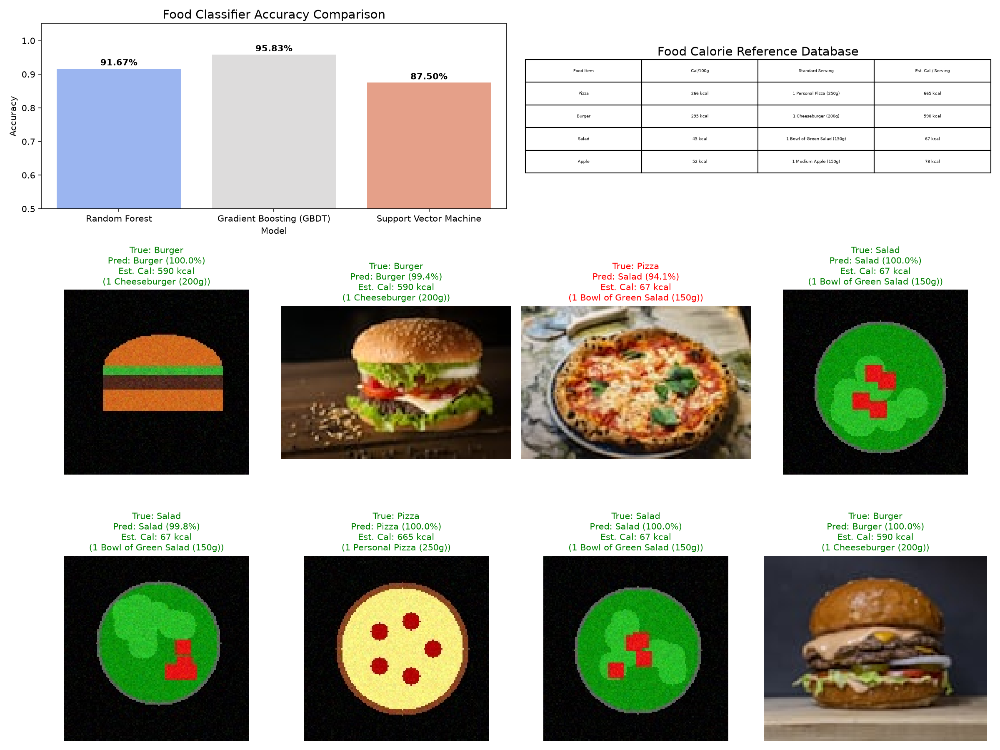

# Food Item Recognition & Calorie Estimation

### Standalone ML Project - Prodigy InfoTech Internship (Task 05)
---

## 📌 Project Overview
This project develops an image recognition classifier to identify food items and estimate their calorie counts. It includes:
* **Calorie Serving Database:** Maps food items (Pizza, Burger, Salad, Apple) to calories per 100g and serving portions.
* **Feature Extraction:** Concatenates **BGR Color Histograms** (color profiles) and **HOG descriptors** (shapes).
* **Multi-Model Comparison:** Trains and compares **HistGradientBoostingClassifier (GBDT)**, **Random Forest**, and **SVM (SVC)**.
* **Calorie Estimator:** Automatically computes and overlays prediction probabilities and estimated calories onto test images.

---

## 📊 Calorie Reference Database
The calorie content mapping is as follows:

| Food Class | Calories / 100g | Standard Serving Portion | Est. Calories / Serving |
|---|---|---|---|
| **Apple** | 52 kcal | 150g (1 Medium Apple) | **78 kcal** |
| **Burger** | 295 kcal | 200g (1 Cheeseburger) | **590 kcal** |
| **Pizza** | 266 kcal | 250g (1 Personal Pizza) | **665 kcal** |
| **Salad** | 45 kcal | 150g (1 Bowl of Salad) | **67 kcal** |

---

## 📈 Model Performance & Results
We trained and evaluated three models on the combined color-shape feature matrix (120 images):
* **HistGradientBoostingClassifier (GBDT):** **`95.83%`** Test Accuracy (Best Model - only 1 misclassification out of 24 test images!)
* **Random Forest Classifier:** **`91.67%`** Test Accuracy
* **Support Vector Machine (SVC):** **`87.50%`** Test Accuracy

### Test Classification Report (Best Model - GBDT):
```
              precision    recall  f1-score   support

       apple       1.00      1.00      1.00         6
      burger       1.00      1.00      1.00         6
       pizza       1.00      0.83      0.91         6
       salad       0.86      1.00      0.92         6
```

---

## 🖼️ Visualizations
Plots are saved as `food_calorie_plots.png`:


* **Accuracy Bar Comparison:** Compares RF vs GBDT vs SVM accuracies.
* **Calorie Lookup Table:** Formatted serving details table.
* **Prediction Grid:** Displays 8 test image files overlaid with predicted label, probability confidence, and estimated calories per serving.

---

## 🚀 How to Run

1. **Batch Pipeline:**
   ```bash
   python food_calorie_estimator.py
   ```
2. **Interactive Jupyter Notebook:**
   Open and execute the cells in `food_calorie_estimator.ipynb`.
